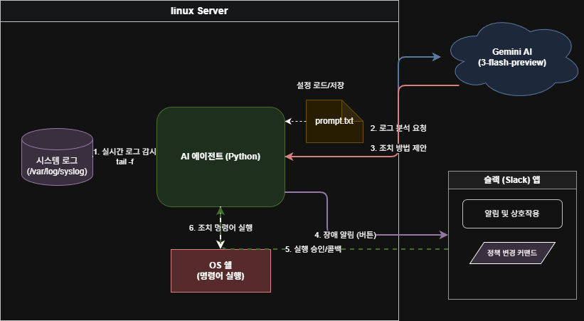
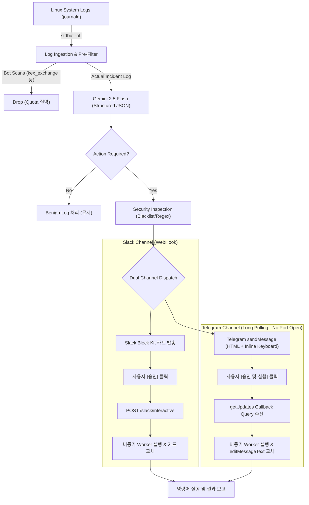
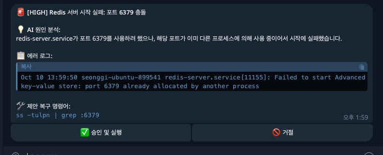
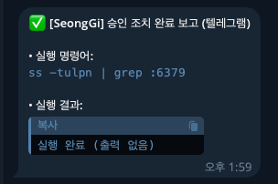

# AI SRE Auto-Remediator (v3.0)

> **Google Gemini 2.5 AI 기반 실시간 리눅스 시스템 장애 탐지 및 자동 복구 에이전트**  
> *(Slack Block Kit & Telegram Inline Keyboard 듀얼 채널 인터랙티브 복구 지원)*



---

## 📌 개요

**AI SRE Auto-Remediator**는 리눅스 서버의 시스템 로그(Journald / Log File)를 실시간으로 감시하다가, 장애가 감지되면 Google Gemini AI가 로그를 정밀 분석하여 최적의 복구 명령어를 추천하고, 관리자가 **슬랙(Slack)** 또는 **텔레그램(Telegram)**에서 버튼 하나로 승인하여 즉각 복구하는 자동화 에이전트입니다.

> 🔗 **개발 배경 및 상세 개선기:** [seonggi.kr/295](https://seonggi.kr/295)

---

## 🌟 주요 특징 (v3.0)

1. **Telegram Bot 인라인 키보드 완벽 지원 (포트 개방 불필요)**
   - Telegram의 **Long Polling (`getUpdates`)** 방식을 채택하여 **서버 외부 포트포워딩/방화벽 개방 없이 사설망/NAT 내부에서도 100% 무설정 동작**합니다.
   - `[✅ 승인 및 실행]`, `[🚫 거절]` 인라인 버튼 클릭 시 원본 알림 카드가 실시간 결과 보고서로 교체됩니다.

2. **Gemini 2.5 Flash & Pydantic JSON Structured Output**
   - 텍스트 파싱 오류를 원천 제거하기 위해 `response_schema` (Pydantic 모델)를 적용하여 정형화된 JSON 진단 결과를 반환받습니다.
   - 외부 봇넷 스캔이나 일상 노이즈는 AI가 스스로 `needs_action: false`로 판별하여 불필요한 명령어 생성을 방지합니다.

3. **스캐너 노이즈 사전 필터 & 60초 디바운스(Deduplication)**
   - 인터넷 공인 IP 환경에서 24시간 발생하는 SSH 봇 스캔(`kex_exchange_identification` 등)을 사전에 드롭하여 API 쿼터를 획기적으로 절약합니다.

4. **Slack 3초 타임아웃 회피 & 비동기 Worker 아키텍처**
   - 슬랙 Interactive 버튼 클릭 시 즉시 200 OK를 회신하고 백그라운드 스레드에서 명령어를 실행한 뒤 `response_url`로 카드를 업데이트합니다.

5. **무지연 실시간 저널링 (`stdbuf -oL`)**
   - 파이썬 파이프의 4KB 블록 버퍼링 지연을 제거하여 에러 발생 1초 이내에 실시간으로 감지합니다.

---

## 🛠️ 시스템 아키텍처



---

## 🚀 빠른 시작 (원클릭 설치)

우분투 서버에서 아래 명령어를 실행하여 설치 스크립트를 구동합니다:

```bash
git clone https://github.com/SeongGi/AI-SRE-System.git
cd AI-SRE-System
chmod +x ai-agent-system.sh
./ai-agent-system.sh
```

설치 시 프롬프트에 따라 다음 정보를 입력합니다:
1. `Gemini API Key`: Google AI Studio에서 발급받은 API 키
2. `Gemini 모델`: `gemini-2.5-flash` (기본값)
3. `Slack Webhook URL`: (선택)
4. `Telegram Bot Token`: `@BotFather`에서 발급받은 봇 토큰 (선택)
5. `Telegram Chat ID`: 관리자 개인 Chat ID (선택)

---

## 📱 텔레그램 봇 실증 화면

| 1. 에러 감지 및 조치 제안 카드 | 2. 승인 클릭 시 실시간 조치 완료 교체 |
| :---: | :---: |
|  |  |

---

## ⚙️ 설정 및 관리

모든 설정은 `/opt/ai-agent/` 디렉토리 내의 텍스트 파일을 통해 서비스 재시작 없이 즉시 변경할 수 있습니다:

| 파일 경로 | 용도 | 설명 |
| :--- | :--- | :--- |
| `/opt/ai-agent/prompt.txt` | SRE 페르소나 | AI에게 부여할 진단 지침 및 선호 유틸리티 지정 |
| `/opt/ai-agent/blacklist.txt` | 보안 차단 목록 | 실행 금지 명령어 (`rm`, `mkfs`, `dd`, `shutdown` 등) |
| `/opt/ai-agent/auto_keywords.txt` | 자동 실행 키워드 | 관리자 승인 없이 즉각 자동 조치할 키워드 (`DISK FULL` 등) |

### 서비스 관리 명령어
```bash
# 실시간 작동 로그 모니터링
sudo journalctl -u ai-remediator.service -f

# 서비스 재시작
sudo systemctl restart ai-remediator.service

# 헬스체크 확인
curl http://localhost:7788/health
```

---

## 📄 라이선스
MIT License.